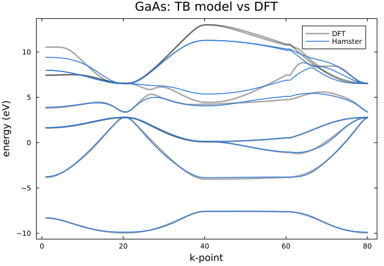

# [2. A first run](@id tutorial-first-run)

**Goal:** compute the band structure of GaAs from existing TB parameters, and learn the structure of a config file.
**Folder:** [`tutorials/02_first_run`](https://github.com/TheoFEM-TUM/Hamster.jl/tree/main/tutorials/02_first_run)

## The config file

Hamster reads its input from a config file, by default `hconf` in the current folder. It consists of blocks
(`begin <label>` … `end`) with one tag per line (`tag = value`, comments start with `#`):

```bash
begin Options
    poscar = ../data/gaas/POSCAR              # primitive cell
    kpoints = ../data/gaas/EIGENVAL_bands     # k-points of the band path (taken from a DFT band structure)
    rcut = 7                                  # cutoff radius (Å), must be the same as in the fit of the parameters
    init_params = ../data/gaas/params_tb.dat  # fitted TB parameters
    load_rllm = true                          # read the distance dependence ...
    rllm_file = ../data/gaas/rllm.dat         # ... from this file instead of computing it
end

begin atom Ga
    n = 3
    alpha = 9
    orbitals = sp3dr2 sp3dr2 sp3dr2 sp3dr2
end

begin atom As
    n = 3
    alpha = 13
    orbitals = sp3dr2 sp3dr2 sp3dr2 sp3dr2
    nnaxes = true                             # orient the hybrids along the bonds
end
```

- The [`Options` block](@ref options-block) contains the general settings: the structure, the k-points and the model
  parameters.
- One [`atom` block](@ref block-atom) per species sets the basis: the orbitals and the radial functions (Slater-type,
  with principal quantum number `n` and effective charge `alpha`). Here, every atom has four `sp3dr2` hybrid orbitals,
  which point along the bonds to the nearest neighbors (`nnaxes = true`, set for one of the two species).
- Without an `Optimizer` block, Hamster performs a [standard run](@ref standard-run): it builds the Hamiltonian and
  computes the eigenvalues at the given k-points.

The model, i.e. `rcut`, the basis and the radial functions, must be the same as in the fit of the parameters. Use
`hamster --tag <name>` to look up any tag, e.g. `hamster --tag nnaxes`, and `hamster --tags atom` for a list of all
tags of the atom blocks.

## Running

```bash
cd tutorials/02_first_run
hamster -t 4
julia --project=../.. plot.jl
```

Hamster writes:

- `Es.dat`: the eigenvalues (bands × k-points),
- `hamster.out`: the settings of the run (all tags with their values, also the defaults) and a summary of the model,
- `hamster.log`: the progress of the run.

`plot.jl` compares the bands with the DFT band structure and prints the mean absolute deviation:



The model has 8 bands (4 orbitals per atom, 2 atoms): the 4 valence bands and the 4 lowest conduction bands of GaAs.

## Things to try

- Look at `hamster.out`: which defaults were used? Which tags have the biggest influence on the result?
- Remove `load_rllm` and `rllm_file`: Hamster now computes the distance dependence itself and writes it to `rllm.dat`.
- Change `alpha` of one species and compare the band structure: the parameters only fit the radial functions they were
  fitted with.
