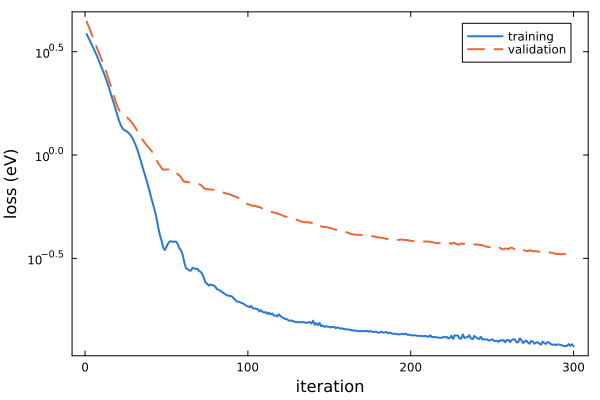
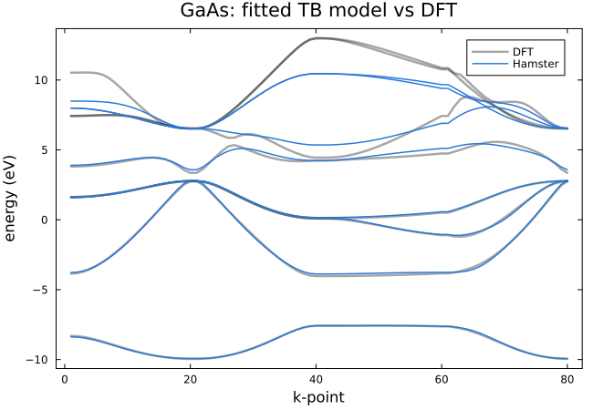

# [3. Fitting a TB model](@id tutorial-tb-fit)

**Goal:** fit the TB parameters of GaAs to the DFT band structure of the primitive cell, and validate the fit.
**Folder:** [`tutorials/03_tb_fit`](https://github.com/TheoFEM-TUM/Hamster.jl/tree/main/tutorials/03_tb_fit)
(exercise: fill in the `???` in `hconf` and `hconf_bands`; solution in `solution/`)

## The Optimizer block

An [`Optimizer` block](@ref optim-tags) turns a run into a [fit](@ref optim-run): the parameters are optimized with
gradient descent (Adam) so that the eigenvalues of the model match the DFT eigenvalues.

```bash
begin Optimizer
    train_data = ../data/gaas/EIGENVAL_train  # DFT eigenvalues for the fit
    val_data = ../data/gaas/EIGENVAL_val      # DFT eigenvalues at other k-points, to validate the fit
    niter = ???                               # number of iterations
    lr = ???                                  # learning rate
    loss = MAE                                # mean absolute error
    wE = ???                                  # weight of every band
    wk_1 = 5                                  # weight of the first k-point (Γ)
end
```

The k-points of the fit are taken from the training data. The weights `wE` (one value per band, or `wE_<i>` and
`wE_<i>-<j>` for single bands and ranges) and `wk` (k-points) select what matters most: here the band gap at Γ, while
the two highest conduction bands are hardly described by a basis of sp3 hybrids and get a small weight.

## Exercise

Fill in the `???` in `hconf`:

1. `rcut`: the parameters of all atom pairs closer than `rcut` are fitted. In GaAs (lattice constant 5.65 Å), the
   nearest neighbors are 2.45 Å apart, the second neighbors 4.0 Å, the third 4.7 Å. Include at least the second
   neighbors.
2. `niter` and `lr`: a few hundred iterations; learning rates of 0.1–0.3 work well for TB fits. Too large values make
   the loss jump, too small ones converge slowly.
3. `wE`: 8 values, one per model band.
4. The basis in the atom blocks: `n = 3` for both species (4th row of the periodic table), and four `sp3dr2` hybrids.

Then fill in `hconf_bands`, a standard run with the fitted parameters (`params.dat`) on the band path, and run
everything with

```bash
./run.sh -t 4        # fit, band structure, figures
```

## Results

The fit writes the parameters to `params.dat` and the losses to `hamster_out.h5` (renamed to `hamster_out_fit.h5` by
`run.sh`). The training loss is weighted with `wE` and `wk`, the validation loss is not, so the two are not directly
comparable; what matters is that the validation loss decreases and then levels off.




## Things to try

- Reduce `rcut` to 4.5 Å (first and second neighbors only): how do the number of parameters (see `params.dat`) and
  the validation loss change?
- Give the band gap at Γ more weight (`wE_4-5`, `wk_1`) and look at the band structure.
- Fit with `lr = 1`: what happens to the loss?
