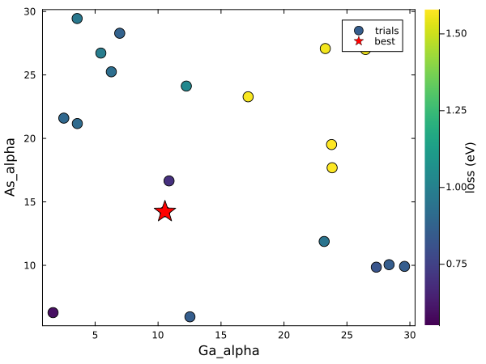

# [4. Hyperparameter optimization](@id tutorial-hyperopt)

**Goal:** optimize the radial functions (`alpha` of Ga and As) of the GaAs TB model.
**Folder:** [`tutorials/04_hyperopt`](https://github.com/TheoFEM-TUM/Hamster.jl/tree/main/tutorials/04_hyperopt)
(example)

## Hyperparameters

The TB fit optimizes the Slater-Koster parameters, but some settings of the model are not fitted by gradient descent:
the radial functions (`alpha`, `n`), `rcut`, and the settings of the ML model (tutorial 6). These hyperparameters are
optimized by a [hyperparameter optimization](@ref hyperopt-run): a series of complete fits (trials) with different
values, each scored by its validation loss.

The effective charge `alpha` of the Slater-type radial functions sets how fast the orbitals decay, and with it how the
matrix elements change with the distance between the atoms. It matters less for the ideal structure, where every
neighbor shell has its own parameters, but a lot for distorted structures (MD snapshots, tutorial 6), where the distances
change.

```bash
begin HyperOpt
    params = Ga_alpha As_alpha        # hyperparameters as <atom or block>_<tag>
    lowerbounds = 1 1                 # search range of each hyperparameter
    upperbounds = 30 30
    niter = 20                        # number of trials (use 100-200 for a real model)
    mode = tpe                        # tree-structured Parzen estimator (also: random, grid)
end
```

Every trial is a fit with the `Optimizer` block; use fewer iterations than in the final fit to save time. The
[`HyperOpt` block](@ref hyperopt-tags) also supports `stepsizes` (grid of the values) and the modes `random` and
`grid`.

## Running

```bash
cd tutorials/04_hyperopt
hamster -t 4                  # a few minutes
julia --project=../.. plot.jl
```

The values and losses of all trials are written to `hamster_out.h5`, and the best values to `hamster.out`.
`plot.jl` shows the validation loss of every trial and the best one:



With only 20 trials, the search is coarse; for a real model, use more trials and a final fit with the best values (as
in tutorial 3). Warnings that an interpolation did not converge can appear for extreme values of `alpha` and are
harmless.

## Things to try

- Run the final fit of tutorial 3 with the best values of `alpha`.
- Optimize `rcut` together with `alpha` (`params = Ga_alpha As_alpha rcut`, with three values in `lowerbounds` and `upperbounds`).
