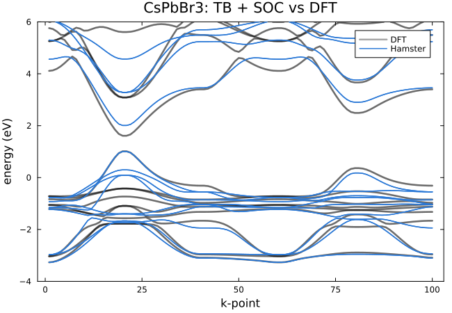

# [5. Spin-orbit coupling](@id tutorial-soc)

**Goal:** add spin-orbit coupling (SOC) to a TB model of CsPbBr₃ fitted without SOC.
**Folder:** [`tutorials/05_soc`](https://github.com/TheoFEM-TUM/Hamster.jl/tree/main/tutorials/05_soc)
(exercise: fill in the `???` in `hconf` and `hconf_bands`; solution in `solution/`)

## Background

In lead halide perovskites, SOC splits the Pb-p conduction bands strongly and lowers the band gap by about 1 eV, so it
cannot be neglected. Hamster describes SOC by an on-site term ``\gamma_s\,\mathbf{L}\cdot\mathbf{S}`` with one parameter per
species (see [Spin-orbit coupling](../models/soc.md)). With SOC, every orbital becomes two spin orbitals: the model of
CsPbBr₃ (Cs s, Pb s p, Br p: 14 orbitals) has 28 bands instead of 14.

We start from the TB parameters of a fit without SOC (`data/cspbbr3/params_tb.dat`), keep them fixed and fit only the
SOC parameters to a DFT band structure with SOC (`data/cspbbr3/EIGENVAL_soc`).

## Exercise

Fill in the `???` in `hconf`:

1. `update_tb`: the TB parameters stay fixed.
2. `bandmin`: in the fit without SOC, the model bands start at DFT band 14 (the bands below are semicore states). With
   SOC, every DFT band appears twice.
3. The block that switches on SOC, with `update` (fit the SOC parameters) and `init_params` (start values; `ones`
   starts at 1 eV). Use `hamster --tags SOC` to see the tags of the block.

In `hconf_bands`, the fitted parameters (TB and SOC) are in `params.dat`; the SOC block needs to know where its
parameters are. Then run

```bash
./run.sh -t 4        # fit, band structure, figures
```

## Results

The fitted parameters `γ_Cs`, `γ_Pb` and `γ_Br` are at the end of `params.dat`; Cs has only an s orbital, so its
parameter has no effect and stays at its start value.



## Things to try

- Compute the band structure without the SOC block (with `bandmin = 14` and `EIGENVAL_bands`, the DFT bands without
  SOC) and compare the band gap at R (k-point 20) with and without SOC.
- Fit the TB and SOC parameters together (`update_tb = true`, more iterations). Does the loss improve?
