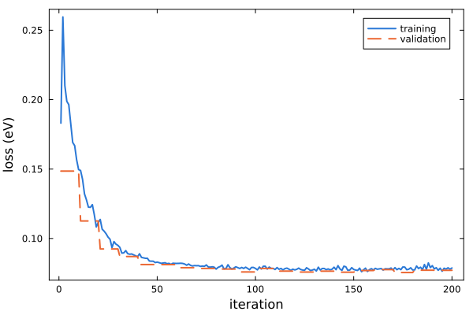

# [6. ML corrections](@id tutorial-ml)

**Goal:** train machine-learned corrections to the TB model of GaAs on snapshots of an MD run.
**Folder:** [`tutorials/06_ml`](https://github.com/TheoFEM-TUM/Hamster.jl/tree/main/tutorials/06_ml)
(exercise: fill in the `???` in `hconf`; solution in `solution/`)

## Background

A TB model fitted to the ideal structure describes small distortions through the distance dependence of its
parameters only. At finite temperature, the atomic environments change in more complex ways (angles, neighbors at
different distances), and the TB model alone becomes less accurate. Hamster adds a correction to every matrix element
(Δ-ML): a Gaussian kernel model that interpolates between a set of reference environments (kernel points), with a
descriptor of the environment of the two atoms of the matrix element (see [Kernel model](../models/kernel.md)).

The corrections are fitted to the eigenvalues of snapshots of an MD run, here 29 snapshots of an 8-atom cell of GaAs
(`data/gaas/structures.h5`, `data/gaas/eigenval.h5`), with the TB parameters of the primitive-cell fit fixed.

## The Supercell and ML blocks

```bash
begin Supercell
    poscar = ...          # reference structure: species and order of the atoms of all snapshots
    xdatcar = ...         # positions of the snapshots (XDATCAR or HDF5 file)
    Nconf = 10            # number of training snapshots ...
    Nconf_max = ...       # ... drawn from the snapshots 1 to Nconf_max
end

begin ML
    npoints = ...         # number of kernel points
    ncluster = ...        # number of k-means clusters used to select them
end
```

The [`Supercell` block](@ref block-supercell) selects the snapshots; with `val_ratio = 1` in the `Optimizer` block,
as many other snapshots are used for validation. The [`ML` block](@ref block-ml) switches on the ML corrections. The
kernel points are selected from the descriptors of the training snapshots: they are grouped into `ncluster` clusters
with k-means, and `npoints` points are sampled from the clusters, weighted by the size and the spread of every
cluster, so that rare environments are represented too.

## Exercise

Fill in the `???` in `hconf`:

1. The `Supercell` block: the reference structure is `data/gaas/SC_POSCAR`, the snapshots are in
   `data/gaas/structures.h5` (29 snapshots).
2. `update_tb` and `lr`: only the ML corrections are fitted, with a learning rate of about 0.01 (much smaller than for
   TB fits).
3. `train_mode` and `val_mode`: the data are snapshots of a supercell (`md`), not a primitive cell (`pc`).
4. `npoints` and `ncluster`: a few hundred kernel points, and about 10 times fewer clusters.

Then run

```bash
hamster -t 4
julia --project=../.. plot.jl
```

## Results

At the first iteration, the ML corrections are zero, so the loss there is the error of the TB model alone on the MD
snapshots. The ML parameters are written to `ml_params.dat`; together with the TB parameters, they form the model that
tutorial 8 applies to a large cell.



`hamster.out` contains a summary of the ML model, with the coverage of the descriptors of the validation snapshots by
the kernel points: descriptors far away from all kernel points get no correction.

## Things to try

- Vary `npoints` (e.g., 50, 250, 500): how do the training and validation losses change?
- Use fewer training snapshots (`Nconf = 3`).
- Optimize `npoints` and `sim_params` (the width of the kernel) with a `HyperOpt` block (tutorial 4), e.g.
  `params = ML_npoints ML_sim_params`.
