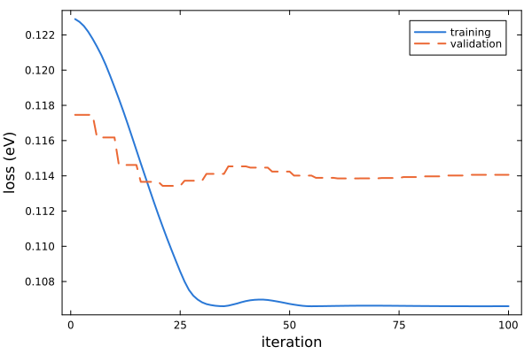

# [7. Electrostatics](@id tutorial-electrostatics)

**Goal:** add electrostatic on-site corrections to a TB model of CsPbBr₃ and test whether they improve the model on MD
snapshots.
**Folder:** [`tutorials/07_electrostatics`](https://github.com/TheoFEM-TUM/Hamster.jl/tree/main/tutorials/07_electrostatics)
(exercise: fill in the `???` in `hconf`; solution in `solution/`)

## Background

In ionic materials, the on-site energies of an atom depend on the electrostatic potential of all other ions, which
fluctuates when the ions move. Hamster can add an on-site shift ``-\gamma_s \phi_i`` proportional to the potential
``\phi_i`` of point charges `qeff` at the site of every atom, with one coupling ``\gamma_s`` per species (see
[Ewald model](../models/ewald.md)). The potential is computed by an Ewald sum or, short-ranged, by the Wolf or Zahn
methods. Short-ranged methods are recommended for models that are applied to cells much larger than the training
cells.

The data are 20 snapshots of an MD run of a 2×2×2 supercell of CsPbBr₃ (40 atoms), without SOC. The TB parameters
are fixed, and only the couplings are fitted. They start at zero (`charge_scale = 0`), so the first iteration shows
the error without electrostatics.

## Exercise

Fill in the `???` in `hconf`:

1. `bandmin`: the valence band maximum is DFT band 176. The model has 9 bands below the valence band maximum per
   primitive cell (Pb s and Br p), and the supercell contains 8 primitive cells.
2. The [`Ewald` block](@ref block-ewald): the Wolf method, couplings that start at zero and are fitted.
3. `qeff` of Cs: the cell must be neutral.

Then run

```bash
hamster -t 4
julia --project=../.. plot.jl
```

## Results

The fitted couplings are written to `params.dat` (`ewald_<element>`), together with the settings of the electrostatics
(method, range, charges) in its header, which are read again in later runs. Compare the training and the validation
losses at the first and the last iteration:



Whether electrostatics improves a model depends on the material and on the other terms of the model. Keep it only if
the validation loss improves, and test it together with the ML corrections (tutorial 6), which also describe a part of
the on-site fluctuations. The config files of the paper models in
[`tutorials/paper_inputs`](https://github.com/TheoFEM-TUM/Hamster.jl/tree/main/tutorials/paper_inputs) show complete
setups.

## Things to try

- Start from `charge_scale = 0.6` with `update = false` (fixed couplings), and with `update = true`.
- Compare `method = ewald` with `method = wolf`.
