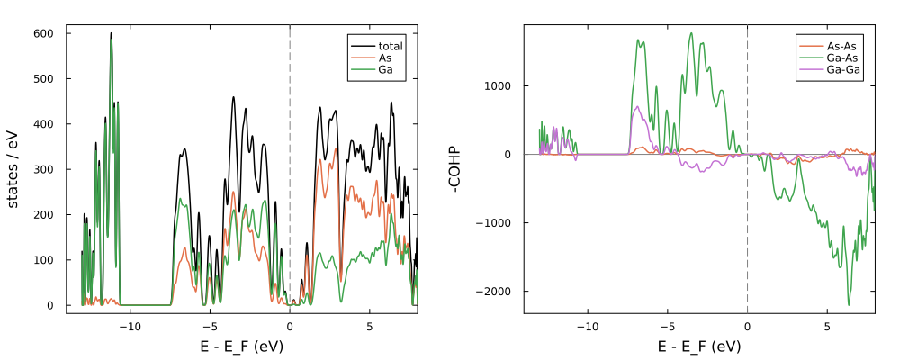

# [8. Applications](@id tutorial-applications)

**Goal:** apply the GaAs model (TB and ML corrections) to a large cell: band edges with a sparse eigensolver, and the
DOS, PDOS and COHP with the kernel polynomial method.
**Folder:** [`tutorials/08_applications`](https://github.com/TheoFEM-TUM/Hamster.jl/tree/main/tutorials/08_applications)
(example)

## A large cell

`make_cell.jl` builds a cell of 4 × 4 × 4 cubic cells of GaAs (512 atoms) with random displacements of the atoms, a
simple stand-in for a snapshot of a large MD run:

```bash
julia make_cell.jl          # writes POSCAR_large; julia make_cell.jl 8 for 4096 atoms
```

The model uses the TB parameters and the ML corrections of tutorial 6 (`data/gaas/ml_params.dat`; use your own
`ml_params.dat` instead if you like). In a standard run, the `ML` block only needs the parameter file; the settings of
the kernel are read from its header.

## Band edges

For large cells, only a few eigenvalues near the band gap are usually needed. With `sp_diag = true`, Hamster uses a
sparse Hamiltonian and a shift-invert eigensolver for the `neig` eigenvalues closest to `eig_target`:

```bash
begin Options
    ...
    sp_diag = true
    neig = 16
    eig_target = 3.2          # an energy in the band gap
end
```

## DOS, PDOS and COHP

The [DOS post-processing](@ref dos-post-processing) computes the DOS, the PDOS and the COHP of every structure. For
large cells, the kernel polynomial method (`method = kpm`) needs only sparse matrix-vector products:

```bash
begin Options
    ...
    skip_diag = true          # no eigenvalues
    dos = all                 # DOS, PDOS and COHP
end

begin DOS
    method = kpm
    kpm_moments = 512         # energy resolution
    kpm_vectors = 16          # random vectors (stochastic error)
    nelec = 2048              # electrons: Fermi energy, integrated DOS and COHP
end
```

`nelec` counts the electrons of the model: every sp3 hybrid basis holds 8 electrons per atom (4 orbitals, 2 spins), and
GaAs has 4 valence electrons per atom.

## Running

```bash
./run.sh -t 4
```

runs both calculations (the DOS first: a run with `skip_diag = true` removes an old `Es.dat`) and `plot.jl`, which
prints the band edges and plots the DOS, PDOS and -COHP (positive: bonding):



The PDOS and COHP show the character of the states *in the model*. A model fitted to eigenvalues only reproduces the
energies, not necessarily the orbital character, in particular with a hybrid basis; compare with a DFT PDOS before you
interpret the PDOS of a model.

## Things to try

- Remove the `ML` block: how do the band edges change without the ML corrections?
- Build a larger cell (`julia make_cell.jl 8`, 4096 atoms) or larger displacements (`julia make_cell.jl 4 0.2`).
- With a GPU, add `device = gpu` (see [GPU support](@ref gpu-support)).
